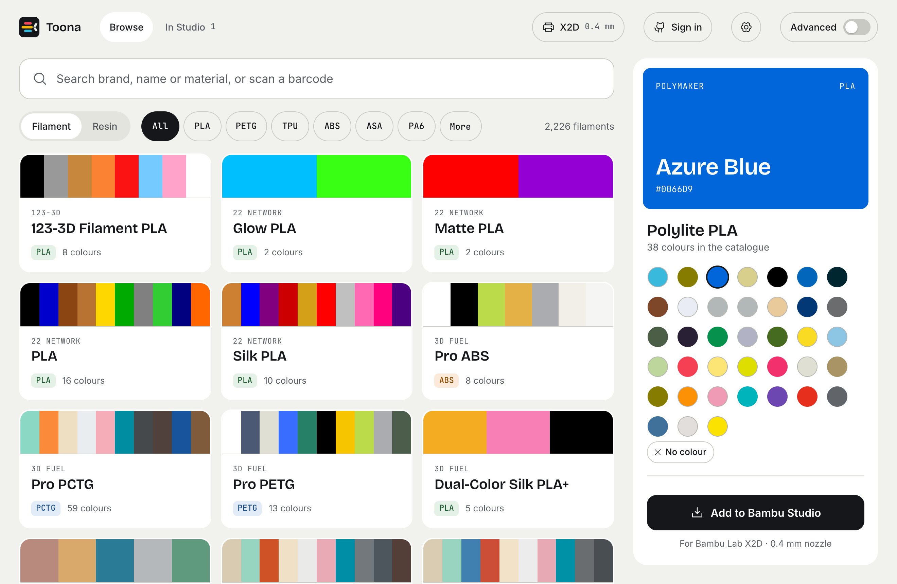
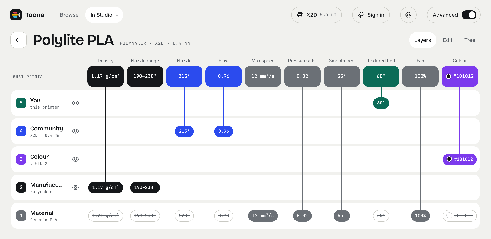
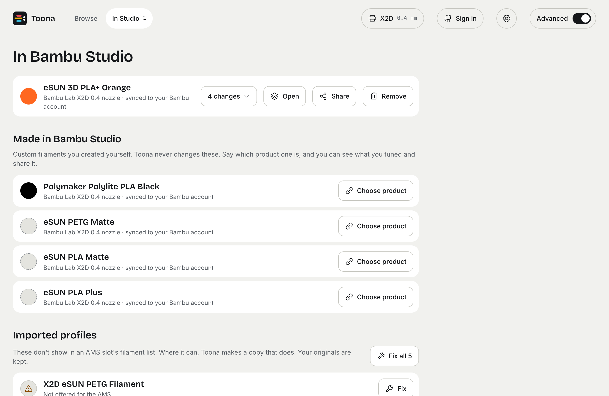

<p align="center">
  
</p>

<h1 align="center">Toona</h1>

<p align="center">
  <strong>Add third-party filaments to Bambu Studio, OrcaSlicer and PrusaSlicer.</strong><br>
  Pick a filament, pick your printer, and it shows up in the slicer.
</p>

<p align="center">
  <a href="https://github.com/dmellok/toona/releases"></a>
  
  <a href="LICENSE"></a>
</p>



Toona is a desktop app that reads the [Open Filament Database](https://github.com/OpenFilamentCollective/open-filament-database) and writes a filament profile that Bambu Studio lists under Custom, the same kind it makes itself with Create Custom Filament. For PrusaSlicer it writes a filament preset that shows under User presets.

It is an early preview. [Download the latest build](https://github.com/dmellok/toona/releases).

| System | Download | State |
| --- | --- | --- |
| macOS, Apple silicon | `.dmg` | The one it is developed and tried on. Signed and notarised by Apple from 0.6.0, so it opens like any other app. |
| Windows, 64-bit | `-setup.exe` | Tried with Bambu Studio. Not code-signed, so Windows will warn before running it. Offers its own updates from 0.6.0. |
| Linux, 64-bit | `.AppImage` or `.deb` | New and not yet tried on a real computer. Also looks for a slicer installed as a Flatpak. |

If you try the Linux build, an [issue](https://github.com/dmellok/toona/issues) saying how it went is very welcome.

Toona looks for each slicer's settings in the usual place for your system. If yours keeps them elsewhere, as a portable copy does, pick the slicer from the menu at the top and choose its settings folder (from 0.6.2). The slicer's own Help, Show Configuration Folder shows where it is.

## What it does

- Browses the catalogue by brand, material and name, or by scanning a spool's barcode.
- Builds each profile on one of the slicer's own presets and changes only what the filament needs, so you can see every setting that differs and why.
- Backs up before it writes, and refuses to write while the slicer is open.
- Lists what it added, lets you edit or remove it, and repairs profiles that were imported in a form Bambu Studio hides.
- Shows how each profile printed for other people on your printer and nozzle, and with a GitHub sign-in lets you say how it went for you.
- Shows multi-colour filaments with all their colours: a blend for ones that change along the spool, bands for dual- and tri-colour ones.
- Optionally, with a GitHub sign-in, shares a profile's changes with other people and shows which shared ones worked for them. G-code is never taken from, or sent to, anyone.

## Every setting, and where it came from

Each profile is built on one of Bambu Studio's own presets. Turn on Advanced and a profile's page shows which settings differ from that preset and which layer set each one: the manufacturer's figures, the colour, a profile someone shared, or your own edits.



## What's in your slicer

The In Studio view (In PrusaSlicer, when that is the slicer chosen) lists what Toona added next to the filaments you made yourself. For Bambu Studio it also lists imported profiles that Bambu Studio hides from the AMS list, which Toona can repair.



## OrcaSlicer

OrcaSlicer takes the same kind of profile as Bambu Studio, and Toona reads the built-in presets of every printer vendor OrcaSlicer has set up, not only Bambu Lab's. Where OrcaSlicer's own filament library already has a preset for a brand's filament, the profile is built on that one. It works with OrcaSlicer 2.5. Printers you made yourself in OrcaSlicer are listed too, from 0.6.1: one created from scratch gets the filaments in OrcaSlicer's shared library, and one made by changing a built-in printer also gets what that printer does. That part is new, so a report of how it went on your printer is welcome. Syncing with Orca Cloud has not been tried.

## PrusaSlicer

With more than one slicer installed, a menu in the header switches between them. PrusaSlicer ties a filament to printers by a condition instead of keeping a file per nozzle, so Toona builds on the preset PrusaSlicer shows for your printer and keeps that preset's condition: one filament can serve several nozzles, and where a printer needs its own it is named PrusaSlicer's way, such as `eSUN PLA+ Orange @MK4S HF0.4`. PrusaSlicer support is new and has been tried on PrusaSlicer 2.9 with Prusa's own printers.

## What it sends

Toona talks to two places: GitHub, to download the catalogue, and `api.toona.wiki`, for shared profiles and update checks. On first run it asks two questions:

- **Check for updates** (on unless you turn it off): when Toona opens it asks whether a newer version exists. The request carries the Toona version and the kind of computer.
- **Share usage numbers** (off unless you turn it on): once a day, the Toona version, system, slicer, printer models, how many filaments were added, and which catalogue products were added since the last time. There is no id and no account, the server keeps only a count per product, and the names of filaments you made yourself are never sent. The first-run sheet shows exactly what would be sent.

## Layout

| Folder | What it is |
| --- | --- |
| `crates/core` | The library: reads the catalogue and the slicer's folders, builds and installs profiles |
| `crates/cli` | A command-line front end to the library |
| `app` | The desktop app: Tauri, with a React window in `app/src` and its backend in `app/src-tauri` |
| `tools` | Scripts that prepare data shipped with the library |
| `PROFILE_SPEC.md` | What a Bambu Studio filament profile is, worked out from real ones |
| `.github/workflows` | Builds the app for macOS, Windows and Linux |

The server behind `api.toona.wiki` is not part of this repository.

## Build

You need Rust and Node.

```
cargo test --workspace
cd app
npm install
npx tauri dev      # run the app
npx tauri build    # make Toona.app and a .dmg
```

A release build also signs the update file, which needs the maintainers' signing key in `TAURI_SIGNING_PRIVATE_KEY`. Without it, add `--config '{"bundle":{"createUpdaterArtifacts":false}}'`.

## Licence

AGPL-3.0-or-later. See [LICENSE](LICENSE).
